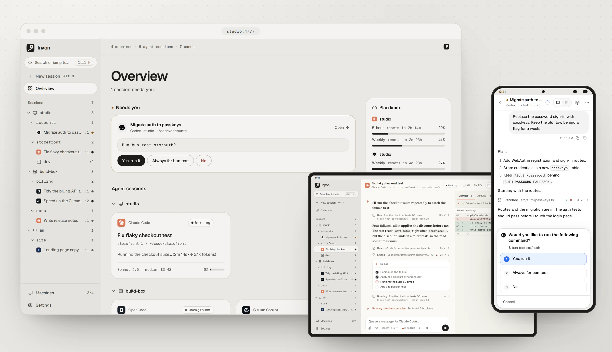
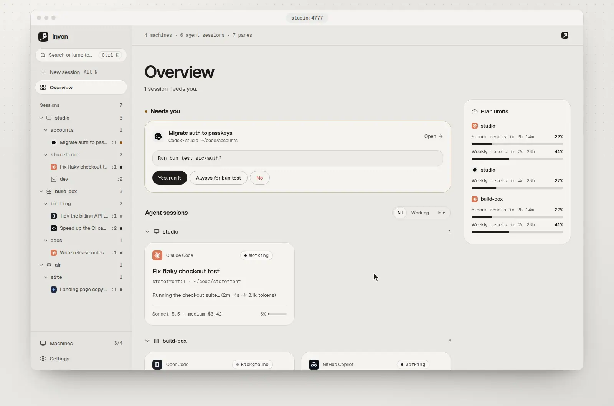
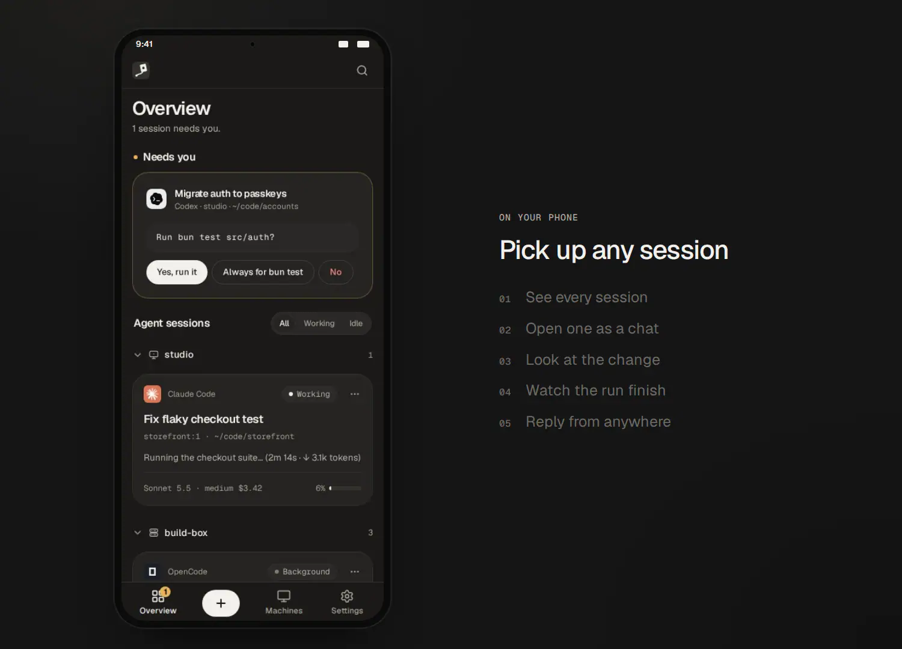
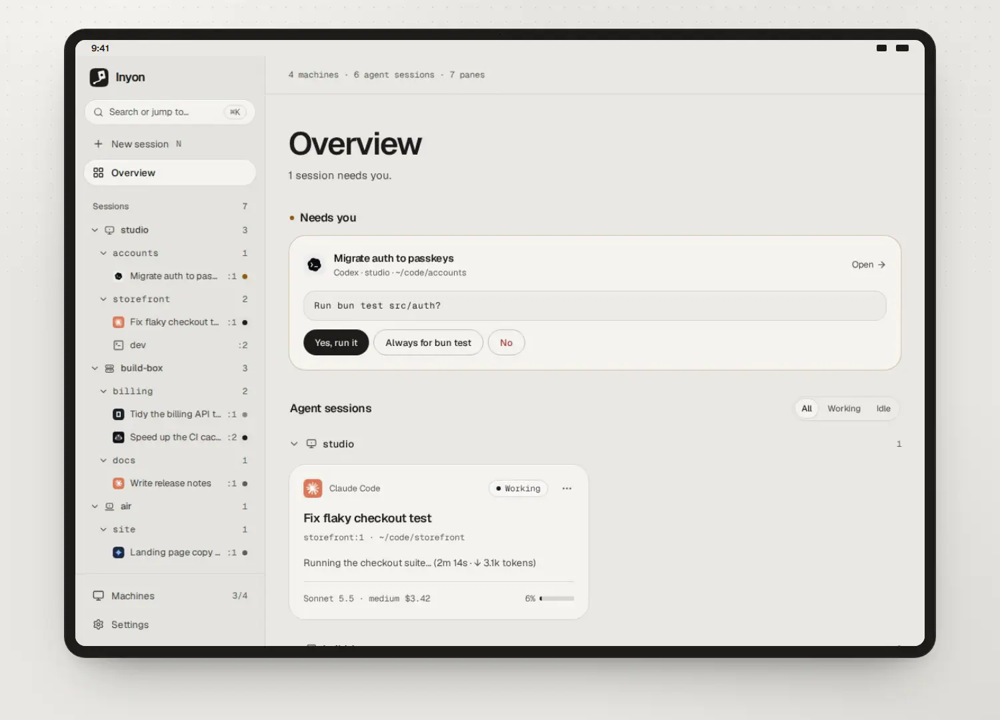
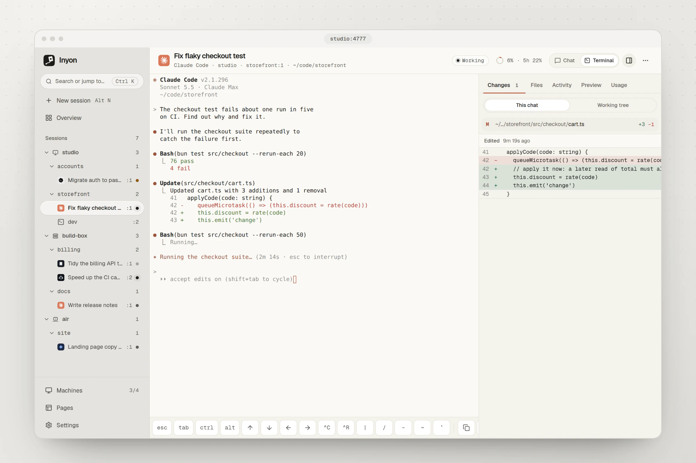
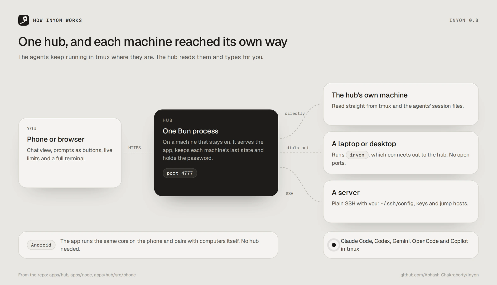

<p align="center"></p>

<h1 align="center">Inyon</h1>

<p align="center">Watch, answer and steer the coding agents running in tmux on your computers, from a phone, tablet or browser.</p>

<p align="center"><a href="https://inyon.abhashchakraborty.tech/">Download</a> · <a href="#quick-start">Quick start</a> · <a href="https://github.com/Abhash-Chakraborty/inyon/releases">Releases</a></p>

<picture>
  <source media="(prefers-color-scheme: dark)" srcset="docs/hero-dark.webp">
  
</picture>

Inyon works with Claude Code, Codex, Gemini CLI, OpenCode and GitHub Copilot, on as many
machines as you have, each signed in to whatever account it already uses. Nothing changes at the
keyboard: walk away from your laptop, pick the session up on your phone, then sit back down and
carry on in the same terminal.

The name comes from 인연 (*inyeon*), the Korean word for a bond between people; 연 on its own
also means kite, which is the mark.

## See it work

Codex asks before it runs the tests. Answer it from the overview, then open the session and watch
the results come in.



On a phone, open a session as a chat, read the change it made, watch the test run finish and send
the next instruction.



On a tablet, sessions sit in a tree by machine and tmux session. Ending one says exactly what
closes, and only that pane goes.



## Why

I run agents on a laptop and two servers. Each is signed in to a different account, and on one
server I only have the CLI. Built-in remote features follow one account at a time, so switching
machines meant switching accounts.

Inyon never signs in anywhere. It drives the agent CLI that is already running in tmux on each
machine, so every machine keeps its own account, subscription or API key.

## What you can do

- Read each session as a chat: formatted replies, tool calls, diffs, plans and to-dos. The full
  terminal is one tap away.
- Answer permission requests, questions, menus and sign-in links with real buttons, straight from
  the overview.
- See the model, reasoning effort, context window, cost, run time and lines changed, plus the
  5-hour and weekly plan limits with their reset times (and Codex credits).
- Switch model, effort and permission mode; set or clear a goal; turn Remote Control on and off;
  compact, clear and rewind.
- Follow everything running in the background: queued messages, shells with live output and a
  real Stop, monitors, subagents and artifacts.
- Type with `/` suggestions for commands, skills and plugins, `@` file search, and images or files
  attached, pasted or dropped in.
- Pick up a draft anywhere. What you type is mirrored into the terminal's input box, and the
  other way round.
- Set up a machine from the app: it checks for tmux and each agent, installs what's missing and
  opens sign-in.

It runs on phones, tablets and desktops, light and dark. Inside a session the app takes on that
agent's colours, logo and reply font; everywhere else it stays ink on silver.

<picture>
  <source media="(prefers-color-scheme: dark)" srcset="docs/phones-dark.webp">
  
</picture>

The terminal is always there too, with a key bar for the keys a phone keyboard lacks and the
session's changes beside it.

<picture>
  <source media="(prefers-color-scheme: dark)" srcset="docs/terminal-dark.webp">
  
</picture>

## How it works



A small hub runs on one machine that stays on. It reaches every other machine in one of three
ways: directly on its own machine, through `inyon` on a laptop (which connects out, so there are no
open ports), or over SSH with your existing `~/.ssh/config`, keys and jump hosts.

On each machine it reads tmux and the agents' own records:

| What | Where it comes from |
|---|---|
| Panes and agents | `tmux` plus the process tree; live changes through a read-only tmux control client |
| Conversations | Claude Code and Codex session files, Gemini CLI chat recordings, OpenCode's local server |
| Prompts and spinners | The pane's screen, parsed into options |
| Plan limits | Claude: the account's usage, read on the machine the same way `/usage` does. Codex: token events |
| Context, cost | Claude's status line data (optional integration) and transcripts, Codex token events |
| Typing and answering | `tmux send-keys`, exactly as if you typed it |

The agents never know Inyon is there. Close it and nothing breaks.

## Agent support

| Agent | Chat view | Live status | Prompts | Notes |
|---|---|---|---|---|
| Claude Code | Full | Full, with the integration | Full | Hooks give exact session matching |
| Codex | Full | Context, limits, credits | Numbered prompts | Reads `~/.codex/sessions` |
| Gemini CLI | Beta | Context | Numbered prompts | Reads `~/.gemini/tmp/*/chats` |
| OpenCode | Beta | Context, cost | Through its API | Talks to the server OpenCode already runs |
| GitHub Copilot | Beta | Context and activity | Native CLI prompts | Reads the running CLI session |

OpenCode sessions that Inyon starts expose a loopback API (`--hostname 127.0.0.1 --port 0`).
Their providers supply the model list and reasoning variants, and Build/Plan picks the OpenCode
agent. A session sharing a folder with another needs an explicit `-s` session ID, and
password-protected OpenCode servers aren't supported yet.

Copilot is found through its process locks and event log. Its models come from the CLI's catalog,
so they match what your account can use. Assisted approval and effort changes stay in the
terminal, and sign-in uses Copilot's device-code flow.

Start a message with `!` to run a shell command through Claude Code, Codex, OpenCode or Copilot.
The agent runs it and handles permissions, and the output shows up in the chat.

## Quick start

The quickest way in is the Android app, with nothing hosted anywhere:

1. Install the APK from the [download page](https://inyon.abhashchakraborty.tech/) or the
   [latest release](https://github.com/Abhash-Chakraborty/inyon/releases/latest).
2. On each computer, run the one line for its system from [Android app](#android-app). It prints
   a QR code.
3. In the app, tap *Add a computer* and scan it.

For a browser, or one place that reaches all your machines, run a hub on a machine that stays on.
On Linux or macOS, this installs it and keeps it running as a user service:

```sh
curl -fsSL https://inyon.abhashchakraborty.tech/get.sh | sh -s -- --hub
```

It prints the address to open and a setup code. Settings like `PORT`, `BIND` or `TLS_CERT` go in
`~/.inyon/hub.env`, one `NAME=value` per line.

To run it from source you need [Bun](https://bun.sh) 1.3+ and tmux:

```sh
git clone https://github.com/Abhash-Chakraborty/inyon.git
cd inyon
bun install
bun run build
bun start
```

The hub listens on `127.0.0.1:4777`. The first visit asks you to create a password, using the
setup code the hub prints when it starts; `inyon hub code` shows it again. Change the password
later in Settings, or choose a new one for a forgotten one with `inyon hub reset-password`.

Reach it from your phone over a private network (Tailscale, Headscale, NetBird, ZeroTier,
WireGuard or your LAN), or put it behind an HTTPS reverse proxy. `inyon hub install` looks for
these networks and prints what to run for each: `tailscale serve` where the tailnet has HTTPS,
`netbird expose` for a public HTTPS address through NetBird's proxy, and otherwise `BIND` on the
network's address. Behind a proxy on a public domain, add that domain to `INYON_ALLOWED_HOSTS`. `deploy/inyon-hub.service` keeps a source install running.

## Where everything runs

With the Android app there's nothing to host. For a browser, the hub is the one thing you run
yourself: one Bun process on a machine that stays on, such as a home server, a VPS or a desktop
that doesn't sleep. It serves the web app itself, so there's nothing to deploy anywhere else.

- In a browser, the hub's address is the app: `http://my-server:4777` over Tailscale or NetBird,
  or `https://inyon.example.com` behind a reverse proxy.
- Installed on a phone from the browser, with system notifications, it needs HTTPS. Use Caddy or
  `tailscale serve`, or set `TLS_CERT` and `TLS_KEY`. The hub then sends Web Push itself, so
  alerts reach a closed tab or installed app, for every agent and for machines going offline.
- The Android app needs nothing hosted. It talks to your computers itself.
- Other machines host nothing. They run tmux and your agents.

[inyon.abhashchakraborty.tech](https://inyon.abhashchakraborty.tech/) is only a download page
and these docs. Nothing there connects to your machines.

Don't open port 4777 to the internet without HTTPS. The hub can run commands on every machine you
add, so anyone who reaches it gets to try your password.

## Adding machines

Laptops and desktops: *Add a machine → This device connects to Inyon*, then run the one-line
command it shows on that machine. It downloads `inyon` from the hub, checks it, and runs it as a
small user service. No sudo, no open ports.

Servers: *Add a machine → Connect over SSH* with `user@host` or an alias from the hub's
`~/.ssh/config`. The server only needs tmux.

Each machine's Setup tab checks for tmux, Node.js and every agent, installs what's missing, and
opens sign-in for each agent in a terminal.

When a machine drops off the network, the hub keeps the last thing it saw on disk. The machine
stays in the list as "Offline · last seen 5 min ago", with its sessions and recent conversation
still readable, and sending waits until it's back. You get a notification after a minute away and
another when it reconnects.

## Updating

Nothing updates by itself. When a release is out, Settings shows *Update available*.

- A hub installed with `get.sh --hub` updates with *Update* or `inyon update`. It downloads the
  release, checks it against SHA256SUMS, swaps it in and restarts, and goes back to the old one if
  the new one doesn't start.
- A hub run from source updates with *Update*, or `bun hub:update` in the checkout. It refuses
  local changes or a branch that can't fast-forward; otherwise it pulls, installs, builds and
  restarts the `inyon-hub` user unit.
- A machine paired with a hub updates from its page under *Machines*. That works for any version,
  because the hub sends a short script that checks the download first.
- The Android app checks this repo's
  [latest release](https://github.com/Abhash-Chakraborty/inyon/releases/latest) once a day.
  *Download* fetches the new APK, and Android installs it over the old one.

Before 0.7.0 the machine program was called `tether-node`. It updates the same way, then moves its
service and files (`~/.tether-node` to `~/.inyon/node`) to the new name a few minutes later. A
Linux or macOS machine that ran it as a Bun script needs the *Add a machine* command once more.

## Android app

`apps/mobile` wraps the same web app with Capacitor, and the phone is its own hub: it runs
Inyon's core in the app (`apps/hub/src/phone`) and reaches your computers itself. There's no
server in between and no password.

### Any computer, from anywhere

On a Mac or Linux machine, run this in a terminal (on a server, in your SSH session):

```sh
curl -fsSL https://inyon.abhashchakraborty.tech/get.sh | sh
```

On Windows, in PowerShell:

```powershell
irm https://inyon.abhashchakraborty.tech/get.ps1 | iex
```

It downloads `inyon`, checks it against the release's SHA256SUMS and prints a QR code. In the app,
tap *Add a computer*, then *Scan the code*. Scanned with the phone's camera instead, the code opens
the download page, which offers to copy the link for the app. If the SSH session is on the same
phone, use the one-time ID and 6-digit code it also prints. The code works once, for 10 minutes, and five wrong
tries cancel it.

`inyon` opens a free Cloudflare quick tunnel, so the phone reaches the computer from any network
without an account or an open port. Phone and computer talk over Noise (IK, X25519,
ChaCha20-Poly1305), so the tunnel only carries ciphertext. The computer publishes its current
addresses under its own key with [pkarr](https://pkarr.org), and a forged record fails the
signature check. `--lan` also answers on the local network, which is faster at home.

On Tailscale, Headscale, NetBird, ZeroTier or WireGuard, `inyon` also answers on that network's
address, and setup says which. The Android app on the same network connects straight to it, with
no tunnel in between. A browser copy (below) only opens `wss://`, so it keeps using the tunnel, or
an HTTPS address you publish with `--url`. With Tailscale, for example:

```sh
tailscale serve --bg --https=8443 http://127.0.0.1:4780
inyon pair --url wss://laptop.tail1234.ts.net:8443/link
inyon install    # restarts the link with the new address
```

`--no-vpn` turns the private network address off. It starts off on Windows, where the firewall
would ask about it.

Setup installs `inyon` as a background service: a systemd user unit on Linux, launchd on macOS, a
logon task on Windows, or a background process with an `@reboot` cron line where there's no
systemd. `inyon uninstall` removes it and keeps your pairings. `inyon phones` lists paired phones
and `inyon forget <name>` unpairs one.

On Windows, Inyon drives [psmux](https://github.com/marlocarlo/psmux), the native tmux for
Windows, and setup installs it with winget. Everything works as on Linux, except that the terminal
is drawn from the pane's screen, so it shows what's on screen now without the scrollback.

### Your own copy in a browser

The same phone core also builds as a static web page, for anyone who wants to serve it
themselves: `inyon-web.tar.gz` in each release, or `bun --filter @inyon/web build:hosted`.
Set `INYON_WEB_URL` on a computer to point its QR codes at your copy. The pairing code rides
after the `#` in the link, which browsers never send to a server, and the page takes it out of
the address bar before anything loads. Pairing keys stay in the browser's IndexedDB, sealed with
a key the browser won't hand out.

Once you allow notifications, the page subscribes with the browser's own push service and hands
the subscription to each paired computer over the encrypted link. When an agent's hook says it
needs you or finished, the computer sends an encrypted message straight to that push service
(RFC 8291), so alerts arrive with the page closed. This needs `inyon` 0.10 or later and today
covers Claude Code. `inyon push` lists the browsers a computer sends to.

A page can't open SSH connections, so a server without `inyon` goes through a paired computer.
On iPhone, add it to the Home Screen first and pair from there: Safari forgets a site after 7 days
unused.

### A server over SSH

If you can't install anything on a server, the phone can use SSH instead, through a native plugin
built on ConnectBot's sshlib.

1. Tap *Add a computer*, then *Can't install anything? Connect over SSH instead*, and give it
   `user@host` and a port.
2. Sign in with the phone's own key, a password, or a private key you paste. The phone's key is
   an ed25519 key made on the phone; the app gives you the one command that adds it to the
   server's `~/.ssh/authorized_keys`.
3. Compare the host key fingerprint the app shows with
   `ssh-keygen -lf /etc/ssh/ssh_host_ed25519_key.pub` on the server. If it ever changes, the app
   refuses to connect until you confirm.

Passwords and keys stay in Android's encrypted storage. The phone has to reach the server, so use
the same Wi-Fi or a VPN. A server on Tailscale SSH lets the phone in with no key at all.

### Getting and building it

Every push to `main` refreshes the "Latest Android build" pre-release, and each `v*` tag attaches
the APK to its release as `inyon-X.Y.Z.apk`, which is where the app looks for updates. A fork
without signing secrets (`ANDROID_KEYSTORE_BASE64`, `ANDROID_KEYSTORE_PASSWORD`,
`ANDROID_KEY_PASSWORD` and the `ANDROID_KEY_ALIAS` variable) gets a debug build.

To build it yourself, with Android Studio installed:

```sh
bun run build
cd apps/mobile
bun x cap sync android
bun x cap open android
```

Android freezes background apps, which drops their connections. *Stay connected* in Settings keeps
a small ongoing notification so alerts arrive right away (Android 15 caps this at 6 hours a day,
reset when you open the app). Notifications for a fully closed app aren't built yet. The iOS
project in `apps/mobile/ios` isn't built or tested.

## Security

The hub can run commands on every connected machine, so only you should reach it. It binds to
localhost by default, stores only a hash of its password and rate-limits sign-ins. Paired
machines connect out with per-machine tokens you can revoke. [SECURITY.md](SECURITY.md) has the
full model and what Inyon changes on a machine.

## Configuration

| Variable | Default | |
|---|---|---|
| `PORT` | `4777` | Hub port |
| `BIND` | `127.0.0.1` | Address to listen on. Anything but localhost needs `TLS_CERT`/`TLS_KEY`, or `INYON_ALLOW_HTTP=1` |
| `INYON_ALLOW_HTTP` | | `1` serves plain http on a network `BIND`, for a VPN address that encrypts on its own |
| `INYON_DATA_DIR` | `~/.inyon` | Password hash, machine list, drafts, settings |
| `INYON_ALLOWED_ORIGINS` | | Extra comma-separated origins allowed to call the hub, for a reverse proxy on another hostname |
| `INYON_ALLOWED_HOSTS` | | Extra comma-separated host names the hub answers to. IPs, single-label names, localhost and Tailscale/NetBird names always work. `*` turns the check off |
| `TLS_CERT`, `TLS_KEY` | | A PEM certificate and key for HTTPS, needed for an installed phone app, clipboard images and notifications |

## Development

```sh
bun install
bun dev:hub        # hub with reload
bun dev:web        # Vite dev server on :5173
bun run typecheck
cd apps/hub && bun test
```

```
apps/hub           Bun server: machines, tmux, agent readers, API, WebSocket
                   (src/phone runs the same core inside the Android app)
apps/web           React + Vite app, also served by the hub
apps/node          the inyon program: the phone link, the hub connection and the hub itself
apps/mobile        Capacitor shell for Android and iOS; scripts/icons.ts renders every icon
packages/protocol  types and the agent registry shared by hub and app
```

Every icon, splash screen and favicon comes from `apps/web/public/icon.svg`; run
`bun --filter @inyon/mobile icons` after changing it. The pictures in this README are the real
app fed a made-up set of machines: `bun run build` in `apps/web`, then
`bun scripts/readme/shots.ts` makes them again. See [CONTRIBUTING.md](CONTRIBUTING.md) to add
an agent or fix a parser.

## Status

Inyon is young. Linux, macOS and Windows (through psmux) work today, and the Gemini, OpenCode
and Copilot readers are still beta.

## License

MIT. See [LICENSE](LICENSE). Agent names and logos belong to their owners; see
[NOTICE.md](NOTICE.md).
