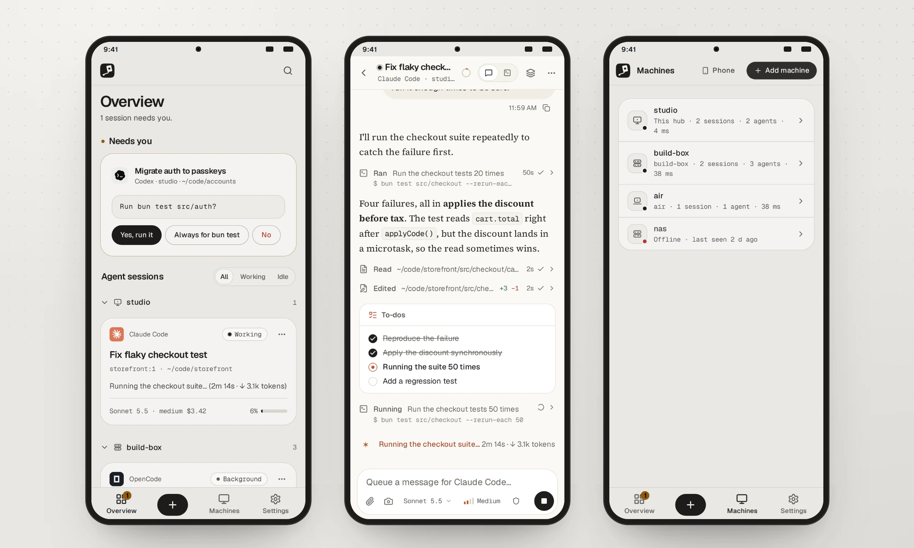

The overview is the first screen. It lists every agent running in tmux on every machine you've added, sorted so whatever needs you is at the top.

## What's on it

- **The status line.** How many machines, agent sessions and tmux panes there are, and what's happening: *2 sessions need you*, *1 working*, or *All quiet. Every session is idle.*
- **Needs you.** Every session waiting on a prompt, as a card with the agent's question and its options as buttons. Tap an option to answer without opening the session. The first option is the filled one, and the card shows **Sending…**, then **Sent** once the agent has moved on. A Claude Code session you let go on counts as working until it finishes its turn. Tap the session's name to open its chat instead.
- **Agent sessions.** A card per session: the agent, its state, the title, the machine and tmux target, the folder, what it's doing now (or when it was last active), the model and effort, the cost so far and how full its context is. With more than three, an *All · Working · Idle* filter appears; with more than six, a search box. Sessions group by machine when you have more than one. When every session is under **Needs you**, this list is left out.
- **Plan limits.** Each machine's 5-hour and weekly limits per agent, with when they reset.
- **Recent activity.** The last few times an agent needed you or finished. A question reads *needs you* only while the session is still waiting on it, then *answered*.
- **Machines.** Each machine with its agents and tmux state, and on a wide screen its **Response** time: how long the machine took to report its sessions at the last check. That includes running the check on the machine, so it isn't a network ping; a Windows machine often takes over a second. **Manage →** opens the list.
- **The integration.** A machine with Claude Code but without Inyon's integration gets a card with **Turn on** (or **Update** for an older one). It shows a spinner until the machine has answered, then says whether it worked.

Sessions waiting on you come first, then working ones, then idle ones, newest activity first within each. Online machines come before offline ones.

## Right-click menus

Right-click a session card, long-press it on a phone, or use its **⋯** menu for **Open**, **Open terminal**, **Open in new tab**, **Rename…**, **Past conversations…**, **Copy session ID** and **End session…**. Ending a session first says exactly what will close: the pane, its window, or the whole tmux session.

From 0.16 most things have a right-click menu, with the same actions wherever they're listed:

| Right-click | For |
|---|---|
| A session, in a card, the sidebar or a machine's page | The actions above |
| A machine, in the sidebar, the overview or Machines | **Open**, **New session**, **Rename…** (**Edit…** for an SSH server), **Update to inyon …** when one is ready, **Remove…** |
| Your message | **Copy message**, and **Rewind to here…** where the agent can |
| The agent's reply | **Copy reply**, and **Copy code** inside a code block |
| The terminal | **Copy**, **Paste**, **Select all** |
| A past conversation | **Switch to it**, **Copy conversation ID** |
| A text box (from 0.17) | **Cut**, **Copy**, **Paste**, **Select all** |
| A file in **Files**, or a changed file in **Changes → Working tree** (from 0.17) | **Open** (**Show diff**), **Mention in message**, **Copy path** |
| A link (from 0.17) | **Open link**, **Open in new tab** for a link inside Inyon, **Copy link** |
| Anywhere else (from 0.17) | **Back**, **Reload**, **Search…** and **New session…** |

With text selected, **Copy** comes first. From 0.17 the browser's own menu, with its *Inspect* and *Save as*, only opens with `Shift` held. If a browser won't let the menu read the clipboard, **Paste** says to press `Ctrl V` (`⌘ V`) instead. On a phone, long-press the sidebar's, a machine's and a past conversation's rows for the same menu; a long press elsewhere still selects text.

## Finding a session

- **Search:** press `Ctrl K` (`⌘ K` on a Mac) or tap the search button on a phone. Touch screens don't show the keyboard hints. Type any part of a session's title, the agent, the machine, the tmux session or window, or the folder. Every word you type has to match. `↑` `↓` and `Enter` open the result.
- **The sidebar** (tablet and desktop) shows every session in a tree: machine, then tmux session, then pane. Folding a branch is remembered, and a folded branch shows a dot when something inside it needs you. With more than eight panes, a filter box appears above the tree.
- **Two machines with the same name**, such as two servers both called `ubuntu`, would look alike. From 0.15 the one you've had longer keeps its name, and the other, if it comes through a paired hub, shows that hub's address after it.

## Titles

A session's title is, in order: the name you gave it, the agent's own title for the conversation, or the agent's name. Rename a session from its header; see [Sessions](sessions.md#renaming).

## Starting a session

Tap **+** (or press `Alt N`, `⌥ N` on a Mac) for a new session:

1. Pick the agent from those installed, or **Terminal** for a plain shell.
2. Pick the machine.
3. Pick the folder; recent folders are offered as chips, shortened to their last two parts (`…\inyon-demo\checkout-service` on Windows). It starts in `~`.
4. Optionally choose the model, the permission mode (Claude Code and Antigravity) and a first message.
5. Choose whether to start a new tmux session or a new window in an existing one, and its name.

**Start** opens the new session. If no machine is online, **+** offers to add one instead.

## Refreshing

The overview updates live. To check right now, pull down on a phone or press the refresh button on a desktop. When the connection drops, a **Reconnecting** marker shows until it's back.
