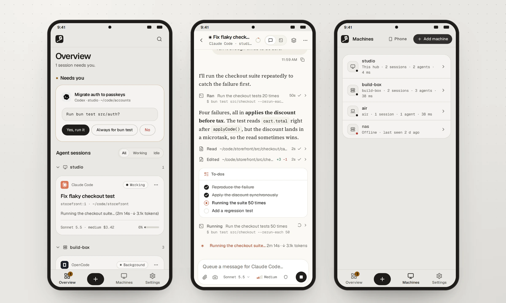

The overview is the first screen. It lists every agent running in tmux on every machine you've added. Each session keeps its place while agents work and ask, so a click lands where you aimed.

## What's on it

- **The status line.** How many machines, agent sessions and tmux panes there are, and what's happening: *2 sessions need you*, *1 session is working*, *1 working, 1 in the background*, or *All quiet. Every session is idle.* Work left running behind an idle prompt (a subagent, a shell) is counted, so it never says *All quiet* while something still runs. When a session needs you, **Show** scrolls to it and puts the focus on its first answer; press it again for the next one (from 0.20.3).
- **Companion.** From 0.22, while the [companion agent](companion-agent.md) runs, one line above the sessions says what it's doing or what it needs from you, and opens its chat. It isn't counted in the status line or listed with the sessions.
- **Agent sessions.** A card per session: the agent, its state, the title, the machine and tmux target, the folder, what it's doing now (or when it was last active), the model and effort, the cost so far and how full its context is. A session is **Working**, **Needs you** or **Idle**. One whose turn ended with subagents or shells still running is **Background** instead, and the card says what's running: *1 shell and 1 agent running in the background*. The *Working* filter includes it. With more than three, an *All · Working · Idle* filter appears; with more than six, a search box. Sessions group by machine when you have more than one. A session waiting on a prompt shows the agent's question on its card and the options as buttons where the model and cost were, so the card keeps its size. Tap an option to answer without opening the session: the first option is the filled one, and the card shows **Sending…**, then **Sent** once the agent has moved on. A Claude Code session you let go on counts as working until it finishes its turn. Until 0.20.2 these sessions moved to a **Needs you** section at the top.
- **Plan limits.** Each machine's 5-hour and weekly limits per agent, with when they reset. From 0.21 Claude's and Codex's show even with no session running, and Codex's say how many limit resets the account has banked (Inyon never uses them). A free Codex plan has only a 30-day window, so it isn't shown.
- **Recent activity.** The last few times an agent needed you or finished. A question reads *needs you* only while the session is still waiting on it, then *answered*. While the pointer or keyboard focus is on the list it holds still, and anything newer waits behind a **1 new** button (from 0.20.3).
- **Machines.** Each machine with its agents and tmux state, and on a wide screen its **Response** time: how long the machine took to report its sessions at the last check. That includes running the check on the machine, so it isn't a network ping; a Windows machine often takes over a second. **Manage →** opens the list.
- **The integration.** A machine with Claude Code but without Inyon's integration gets a card with **Turn on** (or **Update** for an older one). It shows a spinner until the machine has answered, then says whether it worked.

Machines keep the order you added them in, and sessions the order tmux started them in. Nothing re-sorts when an agent starts working, asks something or goes quiet; only its state changes. Until 0.20.2 the list put waiting sessions first and then sorted by activity, so cards moved while you aimed at them. The sidebar's session list keeps the same order. The one change of order is yours: sessions you pin come first (from 0.24, see below).

## Pinning, parking and snoozing

From 0.24 a session's menu can put it where you want it. The hub keeps all of this, so the browser, the phone app and every other device show the same overview, and it stays after the hub restarts.

- **Pin** puts a session under **Pinned** at the top of the overview, across machines, in the order you pinned them. **Unpin** puts it back in its place.
- **Park** moves a session out of the way, into **Parked and snoozed** at the bottom. That section starts folded; its count says how many wait there. The session keeps running. **Undo** on the notice, or **Unpark** in its menu, brings it back.
- **Snooze…** parks a session until a time you pick: **For an hour**, **For three hours**, **Until tomorrow morning** (9:00) or **Until next week** (Monday, 9:00), by the clock of the device you snooze it from. Turn on **Tell me when it's back** for a notification when the time comes; it shows the first line of the session's note, if it has one. It comes with the notices for a finished agent, so a device with **When an agent finishes** turned off in Settings doesn't show it, and the sheet says so. A session on a machine that's offline when its time comes stays snoozed until the machine is back. **Unsnooze** ends it early.
- **Tags…** adds up to 8 tags, typed with commas between them. They show after the folder on the card, as `#review`, and the overview's search box finds sessions by them.
- **Note…** keeps up to 500 characters with the session. A note icon on the card shows it when you point at it, and the search box finds it too.
- **Close when done** ends the session, as **End session…** would, once its agent finishes its next piece of work: it has to work and then sit idle for a few seconds, so setting it on an idle session waits for the next turn. **Keep open when done** takes it back. It still happens if the hub restarts in between, and only once. If the session can't be ended then, the hub tries again a minute later. A hub that only keeps pins and parking doesn't offer it.

A pinned session that you park or snooze moves to the folded section and comes back to **Pinned** after. These choices follow the session, not the tmux pane: one you resume in another pane keeps them, and a pane number that tmux hands out again after a restart doesn't pick up an old session's pins. Sessions that tmux-resurrect puts back in the same place get theirs back. A session that's gone keeps its choices for 30 days in case it returns; one on a machine that's offline keeps them until the machine is back or removed.

A machine on a paired hub shows that hub's pins. A hub older than 0.24 doesn't keep them, so its sessions' menus don't offer these actions.

Scripts can do the same with a signed-in session or a phone's token: `GET /api/organize` returns everything the hub keeps, and `PATCH /api/hosts/<machine>/panes/<pane>/organize` with a body such as `{"pinned": true}`, `{"parked": true}`, `{"snoozedUntil": 1793000000000, "snoozeNotice": true}`, `{"tags": ["review"]}`, `{"note": "…"}` or `{"closeWhenDone": true}` changes one session (`null` clears a field). `POST /api/hosts/<machine>/panes/<pane>/sends` with `{"text": "…", "at": 1793000000000}` keeps a [message to send later](sessions.md#sending-a-message-later), `POST /api/hosts/<machine>/sends/<id>/now` sends it at once, and `DELETE /api/hosts/<machine>/sends/<id>` cancels it. `PUT /api/organize/sleep` with `{"scope": "all", "minutes": 60}` sets [sleep](settings.md#live-numbers) for every session, or with a project's id as `scope` for that project's. Saved prompts, each with a name, the text, an optional project and a star, live under `/api/organize/prompts`; the apps don't show them yet. A machine's token can't use any of these. The hub keeps it all in `~/.inyon/organize.json`.

## In the new app

From 1.1 the new app (at [`/next`](hub.md#the-new-app-at-next) on the hub, and the [Android app](android.md)) pins, parks, snoozes, tags and keeps notes too. It keeps them in the same place as the web app, so a change in one shows in the other.

- **The sidebar** lists every session under **Pinned**, **Sessions**, **Parked** and **Snoozed**. Click a heading to fold it. **Parked** and **Snoozed** start folded, and the app remembers what you fold. A folded heading still shows a dot when a session in it is waiting for you or working. A row shows the session's first tag, a mark when it has a note, and when it was last active, or for a snoozed one when it wakes (`14:00`, `Wed 9:00`).
- **The overview** shows pinned sessions under **Pinned**, and parked and snoozed ones in a folded **Parked and snoozed** section at the bottom.
- **A session's menu** (right-click it, press and hold on a phone, or use the row's **⋯**) has **Open**, **Open terminal**, **Open in new tab** in a browser, **Rename…**, **Pin**, **Snooze**, **Park**, **Tag as**, **Copy**, **More**, **Select** and **End session…**. **Snooze** offers **1 hour**, **3 hours**, **Tomorrow morning** (9:00) and **Next week** (Monday, 9:00), each with the time it ends. **Tag as** lists the session's tags, the tags in use and **New tag…**. **Copy** has the **tmux target**, and the **Conversation ID** and **Folder path** when the session has them. **More** has **Note…** and **Close when done**. A submenu opens beside the menu when you point at it or press `→`, and `←` or `Esc` goes back; on a phone it takes the menu's place, with a back row at the top.
- **A section heading's menu** has **Select all here**, and **Unpin all**, **Unpark all** or **Unsnooze all**.

Parking, snoozing, **Close when done** and any change to several sessions at once show a notice with **Undo**. The new app doesn't offer **Tell me when it's back** yet.

## Selecting several sessions

From 1.1, in the new app, `Ctrl`-click (`⌘`-click on a Mac) sessions in the sidebar or on the overview to select them, and `Shift`-click to select everything in between. On a phone, choose **Select** in a session's menu, then tap others to add or take them out. A bar at the bottom says how many are selected, with **Pin**, **Park**, **Snooze**, **Tag** and **⋯**. Right-click a selected session for the same actions: **Pin selected**, **Park selected**, **Snooze selected**, **Tag selected as** and **Clear selection**. Each one becomes **Unpin**, **Unpark** or **Unsnooze** when every selected session already has it. A plain click or `Esc` clears the selection, and so does using it.

## Right-click menus

Right-click a session card, long-press it on a phone, or use its **⋯** menu for **Open**, **Open terminal**, **Open in new tab**, from 0.24 **Pin**, **Park**, **Snooze…**, **Tags…** and **Note…** ([see above](#pinning-parking-and-snoozing)), **Rename…**, **Rename tmux session…** (from 0.22), **Past conversations…**, **Copy session ID** and **End session…**. Ending a session first says exactly what will close: the pane, its window, or the whole tmux session.

From 0.16 most things have a right-click menu, with the same actions wherever they're listed:

| Right-click | For |
|---|---|
| A session, in a card, the sidebar or a machine's page | The actions above |
| A tmux session's heading in the sidebar (from 0.22) | **Rename tmux session…**, **Copy tmux name** |
| A machine, in the sidebar, the overview or Machines | **Open**, **New session**, **Rename…** (**Edit…** for an SSH server), **Update to inyon …** when one is ready, **Remove…** |
| Your message | **Copy message**, and **Rewind to here…** where the agent can |
| The agent's reply | **Copy reply**, and **Copy code** inside a code block |
| The terminal | **Copy**, **Paste**, **Select all** |
| A past conversation | **Switch to it**, **Copy conversation ID** |
| A text box (from 0.17) | **Cut**, **Copy**, **Paste**, **Select all** |
| A file in **Files**, or a changed file in **Changes → Working tree** (from 0.17) | **Open** (**Show diff**), **Mention in message**, **Copy path** |
| A link (from 0.17) | **Open link**, **Open in new tab** for a link inside Inyon, **Copy link** |
| Anywhere else (from 0.17) | **Back**, **Reload**, **Search…** and **New session…** |

With text selected, **Copy** comes first. From 0.17 the browser's own menu, with its *Inspect* and *Save as*, only opens with `Shift` held. If a browser won't let the menu read the clipboard, **Paste** says to press `Ctrl V` (`⌘ V`) instead. On a phone, long-press the sidebar's, a machine's and a past conversation's rows for the same menu; a long press elsewhere still selects text.

## Finding a session

- **Search:** press `Ctrl K` (`⌘ K` on a Mac) or tap the search button on a phone. Touch screens don't show the keyboard hints. Type any part of a session's title, the agent, the machine, the tmux session or window, or the folder. Every word you type has to match. `↑` `↓` and `Enter` open the result.
- **The search box** above the cards, with more than six sessions, matches the same things, and from 0.24 a session's tags and note too.
- **The sidebar** (tablet and desktop) shows every session in a tree: machine, then tmux session, then pane. Folding a branch is remembered, and a folded branch shows a dot when something inside it needs you. With more than eight panes, a filter box appears above the tree. From 0.22 the companion agent isn't in the tree: it has its own **Companion** item under **Overview**.
- **Two machines with the same name**, such as two servers both called `ubuntu`, would look alike. From 0.15 the one you've had longer keeps its name, and the other, if it comes through a paired hub, shows that hub's address after it.

## Titles

A session's title is, in order: the name you gave it, the agent's own title for the conversation, or the agent's name. Rename a session from its header; see [Sessions](sessions.md#renaming).

## Starting a session

Tap **+** (or press `Alt N`, `⌥ N` on a Mac) for a new session:

1. Pick the agent from those installed, or **Terminal** for a plain shell.
2. Pick the machine.
3. Pick the folder; recent folders are offered as chips, shortened to their last two parts (`…\inyon-demo\checkout-service` on Windows). It starts in `~`.
4. Optionally choose the model, the permission mode (Claude Code and Antigravity) and a first message.
5. Choose whether to start a new tmux session or a new window in an existing one, and its name.

**Start** opens the new session. If no machine is online, **+** offers to add one instead.

## Blueprints

Plans and mockups your agents build open under **Blueprints** (**Pages** before 0.25), the second tab on a phone and a sidebar item on a desktop. Its badge counts the ones that changed since you last opened them. See [Blueprints](pages.md).

## Refreshing

The overview updates live. To check right now, pull down on a phone or press the refresh button on a desktop. When the connection drops, a **Reconnecting** marker shows until it's back.
