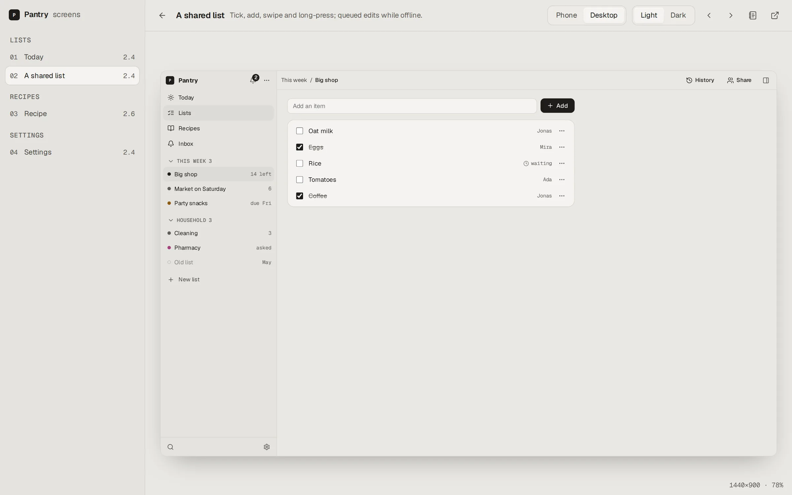

A skill is a folder of instructions and files that a coding agent loads when a task calls for it. From 0.17.7, each Inyon release ships its skills next to the programs, signed the same way. Install them with one command, or download one and unpack it yourself.

## Install with inyon

```sh
inyon skill list             # the skills in the newest release, and where each is installed
inyon skill add blueprint
inyon skill remove blueprint
```

`inyon skill add` downloads `inyon-skill-<name>.tar.gz` from the newest release. It checks the file against the release's signed SHA256SUMS, as `inyon update` does, then unpacks it for each coding agent on the computer:

| Agent | Folder |
|---|---|
| Claude Code (`~/.claude` exists) | `~/.claude/skills/<name>` |
| Codex (`~/.codex` or `~/.agents` exists) | `~/.agents/skills/<name>` |
| Gemini CLI, Antigravity (`~/.gemini` exists) | `~/.gemini/config/skills/<name>` |

If none of these folders exist, the skill goes in `~/.agents/skills`. With `--to <folder>` it goes into that folder instead, for example a project's own `.claude/skills`. Agents pick the skill up in their next session.

Running `add` again replaces the copy with the newest one. It won't overwrite a skill of the same name that you put there yourself unless you add `--force`, and `remove` only deletes copies that `inyon skill add` installed.

## Install by hand

Each skill is on the [download page](/download/#everything-else) as `inyon-skill-<name>.tar.gz`, with its folder at the top level. Check it against the release's list as described in [Checking a download](/download/#verify). Then unpack it into your agent's skills folder:

```sh
tar -xzf inyon-skill-blueprint.tar.gz -C ~/.claude/skills
```

On Windows, `tar` comes with Windows 10 and 11: `tar -xzf inyon-skill-blueprint.tar.gz -C $HOME\.claude\skills`.

## Blueprint

Blueprint turns a plan into a small website instead of a long chat message. Ask your agent for "a plan page", "an HTML plan" or "mockups of the redesign" and it builds a folder with four parts:

- **The plan:** the written plan, with a live "Where it stands" board on top and releases you can open one by one.
- **Screens:** clickable mockups in a viewer that switches between phone and desktop sizes and light and dark. Right-click, long-press, menus, sheets and toasts work.
- **Feature matrix:** one row per feature, with what exists today, its status and the release that brings it, plus search and filters.
- **Progress board:** read from `progress.json`, which the agent updates while it works. The page checks it every 20 seconds.



The skill starts from a working sample site for a made-up grocery app, then replaces it with your project. Its scripts serve the site, take screenshots, and check every screen for console errors and buttons that do nothing:

| Script | What it does |
|---|---|
| `new-site.mjs <dir> --name "App"` | Copies the template into a new folder and marks it with `.inyon-page.json`. Inside a git repository the folder can be left out: it's then `private/plans/<slug>` in the repository's main folder, also from a worktree |
| `publish.mjs <dir> --name "Plan"` | Puts the site under [Pages](pages.md) on a computer with Inyon set up but no `inyon` command on the path. When an agent's sandbox can't write to `~/.inyon`, it prints a line for you to run in your own terminal: the `inyon` command by its full path, or the same `publish.mjs` line when the command isn't installed |
| `serve.mjs <dir> --host <ip> --port 8790` | Serves the site with the same sandbox Inyon puts around a page, so a site that works here works in the app. Use a private address, such as a VPN or home network IP, to open it on your phone |
| `stills.mjs <dir> --audit` | Saves gallery pictures of every screen and reports errors and dead buttons |
| `shoot.mjs <url> <out.png> <w> <h> <light\|dark>` | One screenshot, with optional clicks before it |
| `progress.py task <id> doing\|done` | Updates the progress board |

The scripts need Node 18 or newer and Playwright with Chromium (`bun add -d playwright`, then `bunx playwright install chromium`). With [sharp](https://sharp.pixelplumbing.com) installed, the pictures are WebP. Without it, they're PNG.

From 0.20 the skill publishes a finished site to Inyon with `inyon pages add`, or `publish.mjs` without the `inyon` command, so it opens in the app under [Pages](pages.md) with no server to run. `serve.mjs` is for a computer without Inyon, and for one with Inyon but no hub: there the skill still lists the page, says the app can't open it yet, and serves the site instead of handing over an app link. Every file a site uses sits in its own folder and is linked with a relative path, because a page in Inyon can't load anything from the internet.

> **Note:** A plan page often describes unreleased work. Serve it on a private address rather than the open internet, and keep the folder out of public repositories.
